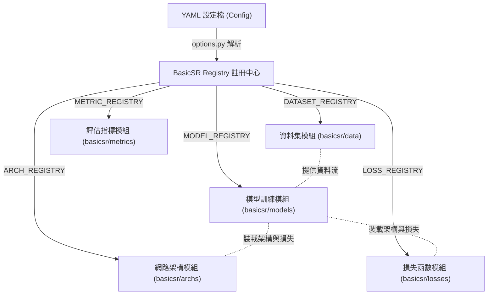
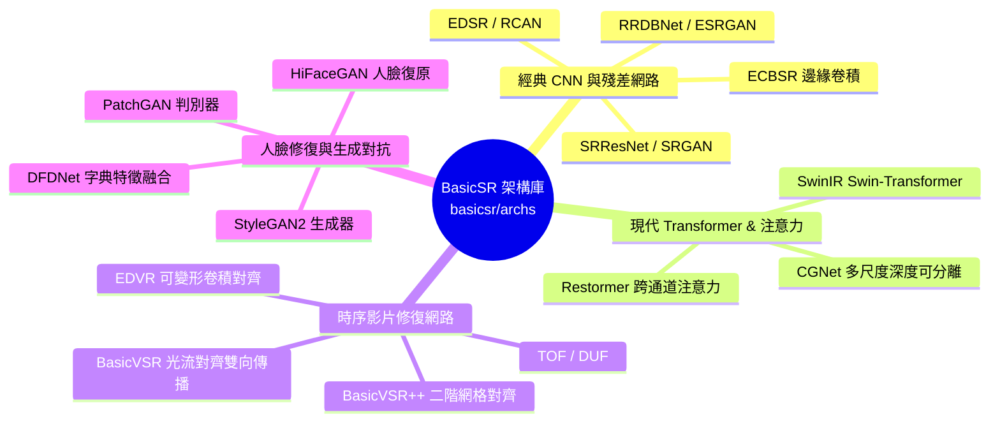

# 🏛️ BasicSR 核心框架全貌視覺化導覽 (Comprehensive Visual Guide)

這份文件專為 **VS Code** 閱讀與預覽設計，從**框架設計哲學**、**五大核心模組**、**訓練推論管線**到**全庫模型支援清單**進行了系統性梳理。建議在 VS Code 中按下 `Ctrl + Shift + V` (Windows/Linux) 或 `Cmd + Shift + V` (macOS) 開啟 Markdown 視覺化預覽！

---

## 📑 目錄與快速導覽
1. [框架核心理念與註冊器模式](#1-框架核心理念與註冊器模式)
2. [BasicSR 訓練與推論完整管線 (Pipeline)](#2-basicsr-訓練與推論完整管線-pipeline)
3. [五大核心系統架構深度解析](#3-五大核心系統架構深度解析)
   - [3.1 Models 模型封裝庫](#31-models-模型封裝庫)
   - [3.2 Archs 網路架構庫 (CNN / Transformer / Video / GAN)](#32-archs-網路架構庫)
   - [3.3 Data 資料集與退化引擎](#33-data-資料集與退化引擎)
   - [3.4 Losses 多維度損失函數](#34-losses-多維度損失函數)
   - [3.5 Metrics 評估指標](#35-metrics-評估指標)
4. [本機環境與 RTX 3060 實踐指引](#4-本機環境與-rtx-3060-實踐指引)

---

## 1. 框架核心理念與註冊器模式

BasicSR 是一個基於 PyTorch 的開源影像與影片修復（超解析度、去噪、去模糊）經典工具箱。其最核心的設計哲學是「**配置驅動 (Configuration-Driven)**」與「**高解耦註冊器模式 (Registry Pattern)**」。

透過 [registry.py](file:///media/stanley/AA5E237A5E233F07/BasicSR/basicsr/utils/registry.py) 提供的五大註冊器，使用者只需修改 YAML 設定檔，即可在不更動任何一行硬編碼的條件下，自由組合不同的資料集、網路架構、損失函數與評估指標：



---

## 2. BasicSR 訓練與推論完整管線 (Pipeline)

整個系統的進入點為 [train.py](file:///media/stanley/AA5E237A5E233F07/BasicSR/basicsr/train.py) 與 [test.py](file:///media/stanley/AA5E237A5E233F07/BasicSR/basicsr/test.py)。以下為標準訓練時的視覺化生命週期：

```mermaid
sequenceDiagram
    autonumber
    actor User as 使用者 / CLI
    participant Train as train.py
    participant Opt as options.py
    participant Data as DataLoader (basicsr/data)
    participant Model as BaseModel (basicsr/models)
    participant Net as Network (basicsr/archs)
    participant Loss as Losses (basicsr/losses)
    participant Logger as TB / Wandb Logger

    User->>Train: 執行 python train.py -opt config.yml
    Train->>Opt: 解析 YAML 並初始化超參數與隨機種子
    Train->>Data: build_dataset() & build_dataloader()
    Train->>Model: build_model() 動態創建模型
    Model->>Net: build_network() 實體化神經網路架構
    Model->>Loss: 初始化 L1 / Perceptual / GAN 損失函數
    
    loop 迭代訓練 (Iterative Training Loop)
        Data->>Model: feed_data(lq, gt) 送入低清與高清影像對
        Model->>Net: forward(lq) 執行前向推論
        Net-->>Model: 回傳預測結果 preds
        Model->>Loss: 計算像素損失與感知損失
        Model->>Model: backward() 反向傳播 + 梯度裁剪 + optimizer.step()
        Model->>Logger: 記錄當前 Loss 與學習率
        
        opt_box 定期驗證 (Validation Frequency)
            Model->>Net: 進入 eval() 模式並推論測試集
            Model->>Model: 計算 PSNR / SSIM / NIQE 評估指標
            Model->>Logger: 儲存 Checkpoint 權重與驗證分數
        end
    end
```

---

## 3. 五大核心系統架構深度解析

### 3.1 Models 模型封裝庫
模組位置：`basicsr/models/`
模型類別 (`Model`) 是封裝「**網路結構 + 訓練邏輯 + 最佳化器 + 損失計算 + 驗證流程**」的控制器。所有模型皆繼承自 [base_model.py](file:///media/stanley/AA5E237A5E233F07/BasicSR/basicsr/models/base_model.py)。

| 核心模型檔案 | 類別名稱 / 別名 | 適用場景與功能特色 |
| :--- | :--- | :--- |
| [sr_model.py](file:///media/stanley/AA5E237A5E233F07/BasicSR/basicsr/models/sr_model.py) | `SRModel` | **單張影像超解析度與修復標準模型**。負責基本的 `feed_data`、`optimize_parameters`、像素損失計算與測試集推論。 |
| [realesrgan_model.py](file:///media/stanley/AA5E237A5E233F07/BasicSR/basicsr/models/realesrgan_model.py) | `RealESRGANModel` | **真實世界盲超解析度模型**。內建二階退化模擬 (Second-order degradation) 與 USM 銳化機制。 |
| [video_base_model.py](file:///media/stanley/AA5E237A5E233F07/BasicSR/basicsr/models/video_base_model.py) | `VideoBaseModel` | **影片超解析度與修復基礎模型**。支援多張連續張量序列 `(B, N, C, H, W)` 輸入與時序特徵對齊。 |
| [edvr_model.py](file:///media/stanley/AA5E237A5E233F07/BasicSR/basicsr/models/edvr_model.py) | `EDVRModel` | 搭配 EDVR 架構的影片模型，支援 TSA (時序空間注意力) 與可變形卷積對齊的訓練預熱機制。 |
| [stylegan2_model.py](file:///media/stanley/AA5E237A5E233F07/BasicSR/basicsr/models/stylegan2_model.py) | `StyleGAN2Model` | **生成對抗網絡模型**。實作了生成器與判別器的交替訓練、R1 正則化與路徑長度正則化。 |
| [restormer_model.py](file:///media/stanley/AA5E237A5E233F07/BasicSR/basicsr/models/restormer_model.py) | `RestormerModel` / `ImageCleanModel` | 整合**漸進式 Patch 訓練**與 Beta Mixup 資料增強，並支援任意尺寸影像的反射填充推論。 |
| [cgnet_model.py](file:///media/stanley/AA5E237A5E233F07/BasicSR/models/cgnet_model.py) | `CGNetModel` / `ImageRestorationModel` | 支援**單頭與多頭 (Multi-Head) 聚合監控**，封裝了 Mixup 增強與梯度裁剪規範。 |

---

### 3.2 Archs 網路架構庫
模組位置：`basicsr/archs/`
純粹的神經網路數學運算結構，負責將輸入張量轉換為輸出張量。BasicSR 涵蓋了影像修復領域四大主流學派的經典架構：



#### 代表性網路結構明細
* **經典單圖超解析度 (SISR)**：
  * [rrdbnet_arch.py](file:///media/stanley/AA5E237A5E233F07/BasicSR/basicsr/archs/rrdbnet_arch.py) (`RRDBNet`)：ESRGAN 的核心生成器，採用密集連接殘差通道塊 (RRDB) 與無 Batch-Norm 設計。
  * [rcan_arch.py](file:///media/stanley/AA5E237A5E233F07/BasicSR/basicsr/archs/rcan_arch.py) (`RCAN`)：引入通道注意力機制 (Channel Attention) 與極深層殘差群組。
* **現代 Transformer 與 CNN 新銳**：
  * [swinir_arch.py](file:///media/stanley/AA5E237A5E233F07/BasicSR/basicsr/archs/swinir_arch.py) (`SwinIR`)：將 Swin Transformer 移動視窗機制應用於影像修復，達到極高的 PSNR 表現。
  * [restormer_arch.py](file:///media/stanley/AA5E237A5E233F07/BasicSR/basicsr/archs/restormer_arch.py) (`Restormer`)：採用 MDTA 跨通道注意力與 GDFN 門控結構，將時間複雜度降至線性的 $O(W^2 C^2)$。
  * [cgnet_arch.py](file:///media/stanley/AA5E237A5E233F07/BasicSR/basicsr/archs/cgnet_arch.py) (`CGNet`)：基於多尺度深度可分離卷積 GCE 與 SimpleGate，具備超高速推論能力。
  * [four_dir_dynamic_cgnet_arch.py](file:///media/stanley/AA5E237A5E233F07/BasicSR/basicsr/archs/four_dir_dynamic_cgnet_arch.py) (`FourDirDynamicCGNet`)：引入四向特徵切片提取與 GatedFusion 空間融合注意力機制。
  * [omnidir_dynamic_cgnet_arch.py](file:///media/stanley/AA5E237A5E233F07/BasicSR/basicsr/archs/omnidir_dynamic_cgnet_arch.py) (`OmniDirDynamicCGNet` / `SOTAFourDirDynamicCGNet`)：結合全向量化四向非對稱深度卷積、分離式空間-通道門控 (Factorized ASC-Gate) 與 NAFNet/Restormer 結構，針對 RTX 3060 12GB VRAM 進行極致優化的 SOTA 影像去噪模型。
* **時序影片超解析度 (VSR)**：
  * [basicvsr_arch.py](file:///media/stanley/AA5E237A5E233F07/BasicSR/basicsr/archs/basicvsr_arch.py) (`BasicVSR`)：利用 SPyNet 估計光流，進行雙向遞迴傳播 (Bidirectional Recurrent Propagation)，為目前影片修復的基準標竿。
  * [edvr_arch.py](file:///media/stanley/AA5E237A5E233F07/BasicSR/basicsr/archs/edvr_arch.py) (`EDVR`)：採用 PCD 金字塔級聯可變形卷積進行對齊，並搭配 TSA 時空注意力融合。

---

### 3.3 Data 資料集與退化引擎
模組位置：`basicsr/data/`
資料管線負責高效讀取硬碟或 LMDB 快取，並進行即時資料增強與退化模擬。

* **資料集類別**：
  * [paired_image_dataset.py](file:///media/stanley/AA5E237A5E233F07/BasicSR/basicsr/data/paired_image_dataset.py) (`PairedImageDataset`)：最常用的雙圖對照讀取器 (如 DIV2K, DF2K)。
  * [realesrgan_dataset.py](file:///media/stanley/AA5E237A5E233F07/BasicSR/basicsr/data/realesrgan_dataset.py)：僅需讀取高清原圖，在記憶體中即時生成複合退化圖像。
  * [reds_dataset.py](file:///media/stanley/AA5E237A5E233F07/BasicSR/basicsr/data/reds_dataset.py) / [vimeo90k_dataset.py](file:///media/stanley/AA5E237A5E233F07/BasicSR/basicsr/data/vimeo90k_dataset.py)：針對經典影片訓練集的連續影格讀取器。
* **線上動態退化引擎 (On-the-fly Degradation Pipeline)**：
  [degradations.py](file:///media/stanley/AA5E237A5E233F07/BasicSR/basicsr/data/degradations.py) 提供了各類逼真的物理退化算子：
  ```mermaid
  graph LR
      HQ["高清影像 (GT)"] --> KERNEL["模糊模糊 (等向/異向高斯、移動模糊)"]
      KERNEL --> DOWN["縮放 (Bilinear / Bicubic / Area)"]
      DOWN --> NOISE["噪聲添加 (高斯噪聲、泊松噪聲)"]
      NOISE --> JPEG["JPEG 壓縮破壞 (diffjpeg 模擬)"]
      JPEG --> LQ["真實世界低清影像 (LQ)"]
  ```

---

### 3.4 Losses 多維度損失函數
模組位置：`basicsr/losses/`
提供優化模型權重的核心目標函數：
* [basic_loss.py](file:///media/stanley/AA5E237A5E233F07/BasicSR/basicsr/losses/basic_loss.py)：
  * `L1Loss` / `MSELoss`：基礎像素級差異 supervisory。
  * `CharbonnierLoss`：平滑版本的 L1 損失 $\sqrt{(x - y)^2 + \epsilon^2}$，能有效處理極端離群值並提升收斂穩定度。
  * `PerceptualLoss`：基於預訓練 VGG 提取深層特徵計算感知損失與風格損失 (Style Loss)，提升視覺紋理真實感。
* [gan_loss.py](file:///media/stanley/AA5E237A5E233F07/BasicSR/basicsr/losses/gan_loss.py)：
  * `GANLoss`：封裝了 Vanilla GAN (BCE)、LSGAN (MSE) 與 WGAN-GP 等多重對抗訓練損失，強化影像銳利度。

---

### 3.5 Metrics 評估指標
模組位置：`basicsr/metrics/`
標準客觀畫質評估量尺：
* [psnr_ssim.py](file:///media/stanley/AA5E237A5E233F07/BasicSR/basicsr/metrics/psnr_ssim.py)：計算 **PSNR (峰值信噪比)** 與 **SSIM (結構相似度)**。內建自動裁剪邊緣 (`crop_border`) 與轉換為 YCbCr 通道評估 (`test_y_channel`) 功能，與 Matlab 官方標準完全對齊。
* [niqe.py](file:///media/stanley/AA5E237A5E233F07/BasicSR/basicsr/metrics/niqe.py)：**NIQE** 無參考自然影像品質評估，指標越低代表影像視覺越自然。
* [fid.py](file:///media/stanley/AA5E237A5E233F07/BasicSR/basicsr/metrics/fid.py)：**FID** 生成影像分佈相似度評估，專門用於衡量 GAN 模型的生成真實度。

---

## 4. 本機環境與 RTX 3060 實踐指引

BasicSR 擁有完善的指令列介面與設定檔彈性。專門針對本機安裝的 **RTX 3060 (12GB VRAM)** 顯卡，我們為專案增添並優化了以下兩份專屬設定檔：

| 設定檔名稱 | 檔案連結 | RTX 3060 專屬優化亮點 |
| :--- | :--- | :--- |
| **Restormer 去噪** | [train_GaussianColorDenoising_Restormer.yml](file:///media/stanley/AA5E237A5E233F07/BasicSR/options/train/Restormer/train_GaussianColorDenoising_Restormer.yml) | `num_gpu: 1` 單卡模式、`batch_size: 4`、動態縮放 `mini_batch_sizes: [4, 4, 2, 2, 1, 1]` 防止 OOM |
| **CGNet 去噪** | [train_GaussianColorDenoising_CGNet.yml](file:///media/stanley/AA5E237A5E233F07/BasicSR/options/train/CGNet/train_GaussianColorDenoising_CGNet.yml) | `num_worker: 4` 穩定 CPU 負載、比例調降 Batch Size 至 4，完美保留 1e-3 學習率與 Mixup |

> 💡 **VS Code 終端機一鍵啟動指令**：
> ```bash
> # 啟動虛擬環境 (若尚未開啟)
> source venv/bin/activate
> 
> # 執行 Restormer 去噪模型訓練
> python basicsr/train.py -opt options/train/Restormer/train_GaussianColorDenoising_Restormer.yml
> 
> # 執行 CGNet 去噪模型訓練
> python basicsr/train.py -opt options/train/CGNet/train_GaussianColorDenoising_CGNet.yml
> ```
